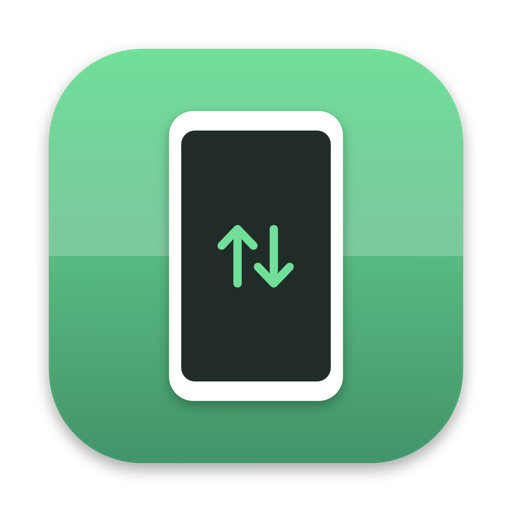
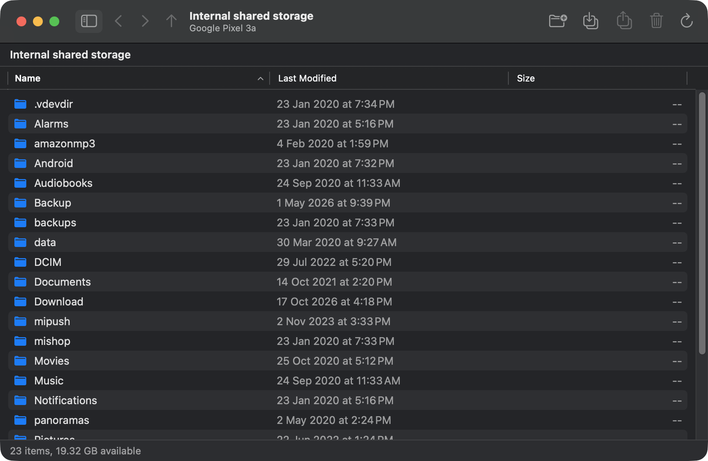

<p align="center">
  
</p>

<h1 align="center">AndroidFT</h1>

<p align="center">
  A native Apple Silicon replacement for Google's abandoned <em>Android File Transfer</em>.<br>
  Plug in your phone, drag files both ways. No Rosetta, no Agent, no ads.
</p>

<p align="center">
  <a href="https://github.com/rajpdus/androidft/releases/latest"></a>
  <a href="#install"></a>
  
  
  
  <a href="https://github.com/rajpdus/androidft/actions/workflows/ci.yml"></a>
  <a href="LICENSE"></a>
</p>

<p align="center">
  
</p>

## Why

Google's Android File Transfer is an Intel-only app from 2018. On an Apple Silicon Mac it runs under Rosetta, installs a login-item "Agent" that grabs your phone's USB port the moment you plug it in, and Google stopped maintaining it. The macOS Finder cannot talk to MTP devices at all.

AndroidFT is the same job done properly: a SwiftUI app, built for arm64, talking to the phone over [libmtp](https://github.com/libmtp/libmtp). The original's behaviour was recovered by decompiling it with [REA](https://github.com/morluto/rea) and Ghidra before writing a line of Swift, so the quirks that made it work on real phones are kept (see [`re/NOTES.md`](re/NOTES.md)).

## Features

- **Browse** every storage on the phone (internal, SD card) with a Finder-style table: name, last modified, size, sortable columns.
- **Drag and drop** files and folders from Finder onto the window to copy them to the phone, and drag items out of the window to copy them to your Mac. Toolbar buttons do the same through open panels.
- **Manage**: new folder, rename, delete (with confirmation, recursive for folders).
- **Hot-plug**: the app watches USB through IOKit and connects the moment the phone is plugged in or switched to *File transfer* mode. No background agent, nothing at login.
- **Progress** sheet with bytes copied and time remaining; cancel at any time.
- **Replace / Replace All / Skip** when a name already exists, the way the original did it.
- Error messages tell you what to actually do (unlock the phone, pick *File transfer* on the USB notification).

## Install

<a id="install"></a>

### Homebrew

```sh
brew install --cask --no-quarantine rajpdus/tap/androidft
```

`--no-quarantine` is needed because the app is signed ad hoc, not with an Apple Developer ID. Without it macOS Gatekeeper refuses to open downloaded builds. If you already installed without the flag:

```sh
xattr -dr com.apple.quarantine /Applications/AndroidFT.app
```

### Download

Grab `AndroidFT-<version>.zip` from the [latest release](https://github.com/rajpdus/androidft/releases/latest), unzip, move `AndroidFT.app` to `/Applications`, then run the `xattr` command above once.

### Requirements

- macOS 14 Sonoma or later, Apple Silicon.
- A phone in **File transfer / Android Auto** USB mode (the notification that appears when you plug it in). Charging-only mode exposes nothing.
- If Google's Android File Transfer is installed, quit it and remove *Android File Transfer Agent* from **System Settings → General → Login Items**. The Agent claims the phone's USB interface and blocks every other MTP client.

## Use

1. Plug the phone in and unlock it. Choose *File transfer* on the phone's USB notification.
2. AndroidFT opens the first storage. Use the sidebar button (⌘⌃S) to switch between internal storage and an SD card.
3. Double-click folders to enter them. ⌘[ / ⌘] go back and forward, ⌘↑ goes to the enclosing folder.
4. Drag files in or out. Or select items and use **Copy to Mac** / **Copy to Device** in the toolbar.
5. ⇧⌘N makes a folder, ⌘⌫ deletes the selection, right-click for rename.

Files cannot be opened in place: MTP is not a file system. Copy them to the Mac first, as the original app also required.

## How it works

```
SwiftUI views ── AppModel (navigation, transfers, conflict prompts)
                    │
                    ├── MTPSession     one serial queue around libmtp:
                    │                  detect, open, storages, list, get, send,
                    │                  create folder, delete, rename
                    └── DeviceWatcher  IOKit IOUSBHostDevice notifications, 1 s debounce
                                       │
                               libmtp 1.1.23 ── libusb 1.0 ── USB ── phone (MTP/PTP)
```

The release build bundles libmtp and libusb inside `AndroidFT.app/Contents/Frameworks`, so nothing else needs to be installed. Development builds link the Homebrew copies.

### Reverse engineering the original

The original app is a thin Cocoa UI over a C++ `MTPRepository` class and a Google-patched libmtp. Its Objective-C class map, the decompiled device-open sequence (uncached open, the Samsung retry, the 20 s timeout), the per-storage path cache, the transfer and progress contract, and the login-item Agent's IOKit hot-plug logic are written up in [`re/NOTES.md`](re/NOTES.md). The analysis used REA's `inspect-macho`, `inspect-native-dispatch-metadata`, `decode-interface-builder` and Ghidra-backed `function` commands; the wrapper script `re/rea.sh` reproduces the environment.

## Build from source

```sh
brew install libmtp
git clone https://github.com/rajpdus/androidft.git
cd androidft
swift build                 # debug binary in .build/debug/AndroidFT
./scripts/bundle.sh         # build/AndroidFT.app with libmtp/libusb embedded
```

`swift test` runs an end-to-end test against an attached phone: it creates a scratch folder at the storage root, uploads 1 MiB of random data, lists it, downloads it back and compares bytes, renames it and deletes the folder. The test skips when no MTP device is attached.

`scripts/release.sh 0.2.0` stamps the version, builds the bundle and writes `build/AndroidFT-0.2.0.zip` plus `SHA256SUMS.txt`. Pushing a `v*` tag runs the same in GitHub Actions and publishes a release.

## Troubleshooting

| Symptom | Cause / fix |
|---|---|
| "No Android device found" | Phone not in *File transfer* mode, cable is charge-only, or the phone is still locked. |
| "Can't access device storage" | Phone is locked, or USB mode is *Charging only*. The app retries every 3 s. |
| Console shows `libusb_claim_interface() = -3` | Another process holds the device: Google's Android File Transfer (and its Agent), Android Studio, `adb` with MTP, or a second copy of AndroidFT. Quit it and press Refresh. |
| App refuses to open after download | Gatekeeper and the ad-hoc signature. See [Install](#install). |
| Copy of a 4 GB+ file fails | Some phones format their shared storage as FAT32. Split the file or use a phone with exFAT/ext4. |

## License

MIT. Bundled libmtp and libusb are LGPL-2.1; see [THIRD_PARTY_NOTICES.md](THIRD_PARTY_NOTICES.md). Android is a trademark of Google LLC; this project is not affiliated with Google.
